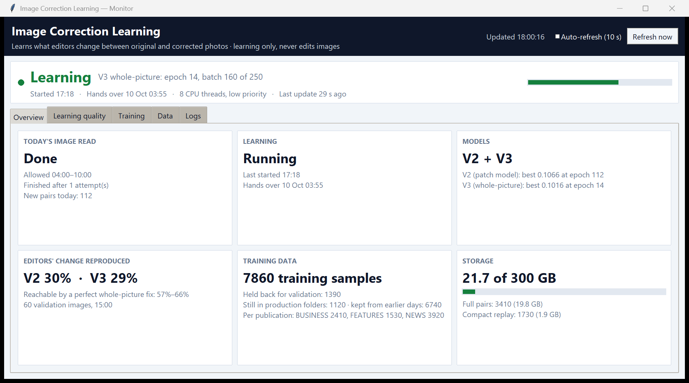
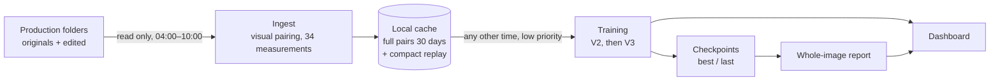
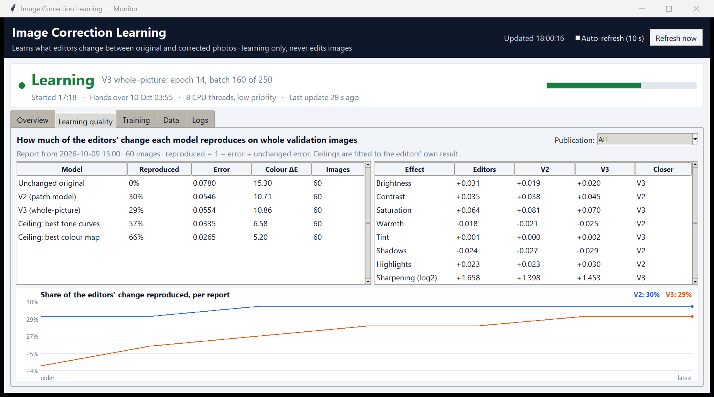
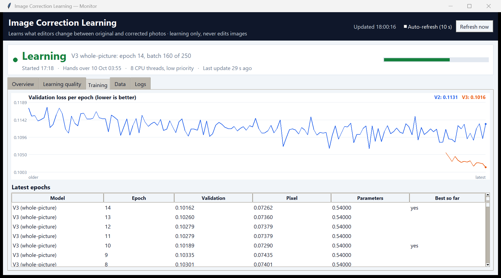

# Image Correction Learning

A Windows service that learns how a newspaper's photo editors correct pictures.
Every day it pairs original photos with the editors' Photoshop-corrected versions,
measures what changed (tone, colour, detail), trains models to reproduce those
edits, and reports how close each model gets on whole images. It is learning
only: it never changes a production image.



*Screenshots show demo data.*

## Highlights

- **Automatic pairing, even after renaming.** Originals are matched to their edited
  versions by picture content: perceptual hash, ORB features, layout and edge
  similarity, colour histograms and timing. Pairs must be each other's best match
  by a clear margin, so lookalikes are rejected rather than guessed.
- **34 measured correction effects per pair**, including brightness, contrast,
  white balance, tone percentiles, saturation, clipping, sharpening, noise and entropy.
- **Three model families, trained side by side:**
  - a residual U-Net with channel attention (2.0 M parameters) and an
    interpretable head that predicts the 34 effects;
  - a whole-picture variant (V3) that predicts per-image tone curves and a colour
    mix from a view of the entire photo. It is warm-started so it reproduces V2
    exactly before its first update, and it trains only its own 220 k parameters;
  - a pix2pix GAN (57 M parameters), kept as an experiment.
- **Honest evaluation.** A daily report scores every model on whole held-out images
  against a "do nothing" baseline and against the best a per-image correction could
  possibly reach, per publication and per effect.
- **Safe operations:**
  - production folders are read only between 04:00 and 10:00;
  - verified pairs are copied into a tiered local cache: full-resolution pairs
    for 30 days, then compact replay samples, 300 GB cap;
  - learning runs from the cache at any other time, at low CPU priority;
  - one process (single-instance mutex plus watchdog), atomic checkpoint writes,
    and it can be stopped safely at any moment.
- **Live desktop dashboard** and **85 automated tests**, run on Windows CI.

## Results so far

Measured on held-out whole images (768 px). "Reproduced" is 1 − (error ÷ error of
leaving the image unchanged).

| Correction | Share of the editors' change reproduced |
|---|---|
| Leave the image unchanged | 0% |
| One fixed preset per publication | 4–10% |
| **V2, patch model** | **24–30%** |
| V3, whole-picture model | 23–29% |
| Ceiling: best per-image tone curves | 57% |
| Ceiling: best per-image 3D colour map | 66% |

The ranges cover a 60-image benchmark and the service's daily rolling report. The
ceilings are fitted to the editors' own result, so no model can beat them with a
whole-picture correction alone.

What the measurements showed:

- **The pairs are well aligned** (median shift 0.03 px), so they are good
  supervision.
- **Edits are image-specific.** A fixed preset per publication explains only
  4–10% of the change, but a per-image colour map would explain 66%. The remaining
  gap is image-wide tone and colour decisions, which is what the next model
  iteration targets.
- **Sharpening differs by publication**, from ×2.0 to ×4.3 in fine detail.
- **Engineering lessons:**
  - scoring random validation crops made model selection follow noise (about
    ±0.002), so validation crops are now fixed;
  - resumed weights are re-scored before they can be replaced;
  - each decoded image yields several training patches, cutting decoding work
    by 4×.

## How it works



| Time | What runs | Reads production images? |
|---|---|---|
| 04:00–10:00 | **Ingest**: find new original/edited pairs, copy them to the local cache, measure them. Stops cleanly between files when the window closes. | Yes, read only |
| Any other time | **Learning** from the cache: V2, then V3, until neither improves. It then idles until the next ingest, and hands over at 03:55. | Never (enforced in code) |

Details of data, models, training and evaluation are in
[docs/MODEL_CARD.md](docs/MODEL_CARD.md).

| Learning quality | Training |
|---|---|
|  |  |

## Repository layout

```
src/
  learning_service.py       the service: schedule, ingest, learning, watchdog, live status
  analyze.py                ingest: pair discovery, local cache, per-pair measurements
  train.py                  training (V2, V3, pretrained variant), validation, resume
  evaluate_whole_images.py  whole-image report per publication and per effect
  native_dashboard.py       desktop dashboard (Tkinter)
  stop_service.py           stops the service and dashboard
  pix2pix_train.py          pix2pix experiment
  correction_ml/            models, dataset, pairing, cache, metrics, inference
  secure_pix2pix/           GAN models, data loading, write-safety checks
  tests/                    85 tests
  *.spec                    PyInstaller builds for the service, dashboard and stop tool
docs/                       model card, pix2pix notes, screenshots
```

## Run it

Windows, Python 3.13, CPU only.

```powershell
cd src
python -m pip install torch==2.8.0 torchvision==0.23.0 --index-url https://download.pytorch.org/whl/cpu
python -m pip install -r requirements.txt pytest
python -m pytest -q
```

To learn from your own photos, put original/edited folders in
`config.server.json` (`image_sets`, `read_only_roots`), then:

```powershell
python analyze.py --config config.server.json --artifacts artifacts
python train.py --config config.server.json --artifacts artifacts --cache-only artifacts\training_cache --epochs 20
python evaluate_whole_images.py --artifacts artifacts
python native_dashboard.py
```

Or run the whole schedule as a service with `python learning_service.py`. Build
the Windows executables with PyInstaller from the three `.spec` files.

## Data and safety

- This repository contains code only. It holds no photographs, no trained models
  and no real configuration; the paths in the config files are placeholders.
- The system never writes inside the production folders: output paths inside them
  are refused.
- Applying corrections stays disabled while `learning_only` is true. Corrections
  are meant to be switched on only after the reports show the learning is good
  enough.

## Built with

Python · PyTorch · OpenCV · scikit-image · Pillow · Tkinter · PyInstaller ·
pytest · GitHub Actions
